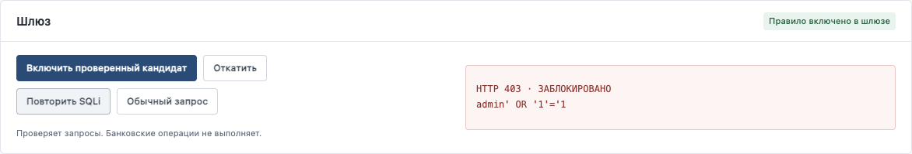

# BankTrap

Локальный стенд для проверки защитных правил на примере банковского веб-приложения.

Приманка записывает подозрительный запрос. Оператор создаёт правило из шаблона, проверяет его на атакующих и обычных запросах, включает в тестовом шлюзе и при необходимости откатывает.



## Запуск

Нужен Python 3.10 или новее. Внешних зависимостей нет.

```bash
python3 app.py
```

На Windows:

```powershell
py -3 app.py
```

Откройте **http://127.0.0.1:8765**. В разделе «Доступ оператора» вставьте токен из терминала и нажмите «Подключить SOC».

Если порт занят: `python3 app.py --port 8766`. Остановка — Ctrl+C.

## Демонстрация

1. Нажмите «Сбросить демо».
2. В тестовом шлюзе нажмите «Повторить SQLi» — получите HTTP 200.
3. В тестовом банке нажмите «Подставить SQLi», затем «Войти».
4. Нажмите «Создать кандидат» и «Проверить на наборе».
5. Включите проверенный кандидат и повторите SQLi — получите HTTP 403.
6. Нажмите «Обычный запрос» — получите HTTP 200.
7. Скачайте отчёт. Нажмите «Откатить» и повторите SQLi — снова HTTP 200.

[Скриншоты всех этапов](SCREENSHOTS.md) · [Запись видео и текст озвучки](DEMO.md)

Для демонстрации из второго терминала:

```bash
python3 demo.py
```

Введите токен из окна сервера. Скрипт работает только с локальным адресом. При другом порте: `python3 demo.py --port 8766`.

## Проверки

```bash
python3 -m unittest -v test_app.py
```

Тесты проверяют полный HTTP-сценарий, включение и откат правила, обычные запросы, доступ к управлению, входные данные и отсутствие паролей в журнале. Используются временная база и локальный сервер.

На открытом демонстрационном наборе: TP=8, FN=0, FP=0, TN=12. Отдельно сохранены два примера пропущенных атак и пример ложной блокировки. [Подробности проверки](../VALIDATION.md).

## Файлы

- `app.py` — HTTP API, журнал SQLite, шаблон правила и тестовый шлюз.
- `static/` — интерфейс; внешние CDN и сервисы не используются.
- `corpus.json` — тестовые запросы и известные ограничения.
- `test_app.py` — интеграционные тесты.
- `demo.py` — демонстрация через терминал.
- `docs/` — инструкции и скриншоты работающего приложения.

## Ограничения

Это локальный прототип. Сервер слушает только `127.0.0.1`; все компоненты работают в одном процессе. Не используйте реальные пароли, клиентские данные и доступы к банковским системам.

SQL-инъекция имитируется: пользовательский SQL не выполняется. Правило `banktrap-demo/v1` предназначено только для тестового шлюза и не совместимо напрямую с WAF банка. В шлюзе выполняется проверка запроса, а не аутентификация или банковская операция.

Детектор покрывает ограниченный набор SQLi-шаблонов. Он пропускает AND/time-based SQLi и может блокировать обычный логин с SQL-фразой. Демонстрационный набор открыт и не позволяет оценить качество на реальном трафике. Подбор паролей считается по демосессии, которую можно сменить.

Пароли не сохраняются. SQL-подобный логин может сохраняться как пример атаки. База содержит последние 2 000 событий; интерфейс и экспорт — последние 100. Токен меняется при запуске. Правило и демосессии хранятся в памяти, после перезапуска правило выключено. Кнопка сброса удаляет журнал этого стенда.

Перед банковским пилотом нужны раздельные контуры, корпоративные доступы, адаптер WAF, согласованные правила обработки данных и независимый набор тестов.

## Загрузка на GitHub

Создайте пустой репозиторий на GitHub без автоматически добавляемых README, `.gitignore` и лицензии. Из локальной папки проекта выполните, подставив адрес своего репозитория:

```bash
git remote add origin https://github.com/USERNAME/banktrap.git
git push -u origin main
```

Если `origin` уже есть, вместо первой команды используйте `git remote set-url origin ...`.

Если проект распакован из ZIP с исходниками, в нём нет истории Git. Сначала выполните:

```bash
git init -b main
git add app.py corpus.json demo.py test_app.py static docs README.md VALIDATION.md .gitignore
git commit -m "feat: add BankTrap local demo"
```

Затем добавьте remote и отправьте ветку командами выше. Репозиторий `mvp` в исходной папке уже содержит Git-историю; для него повторная инициализация не нужна.
