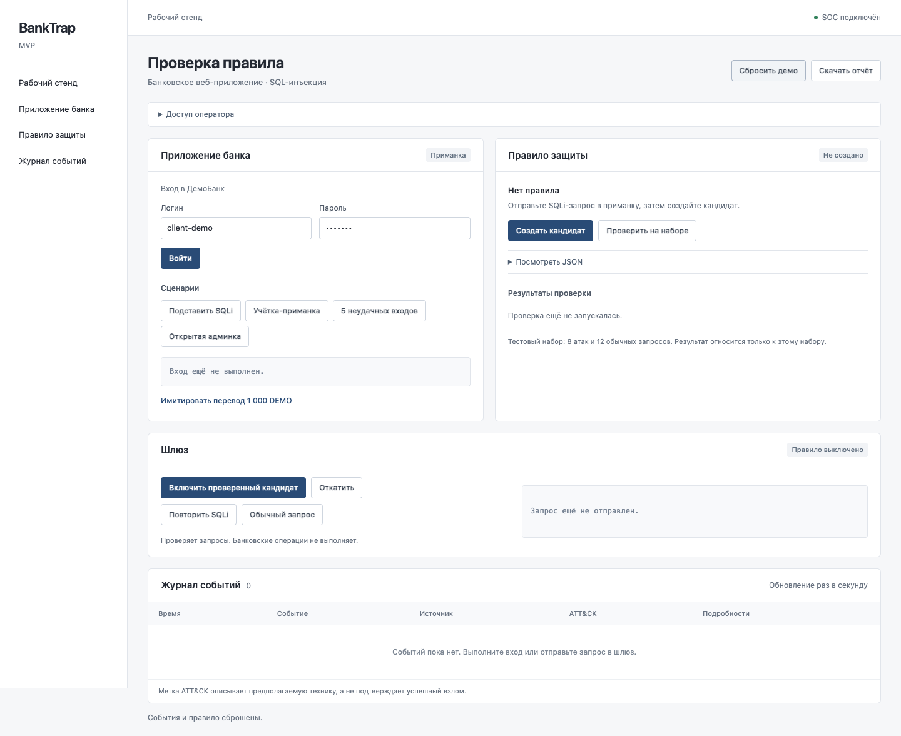
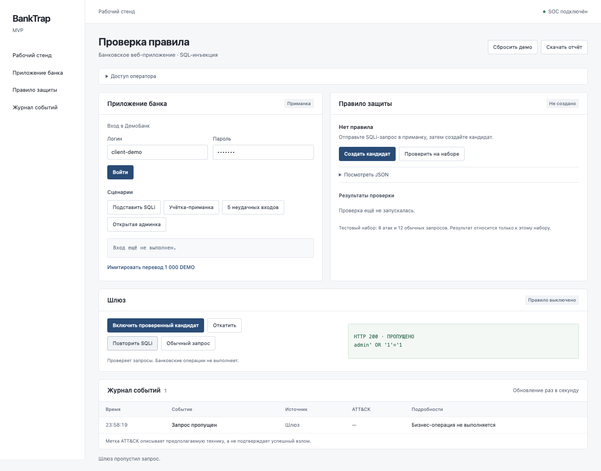
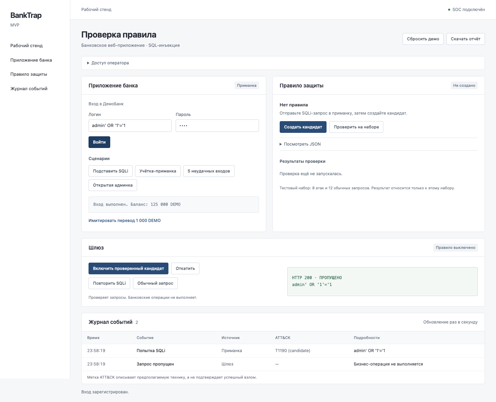
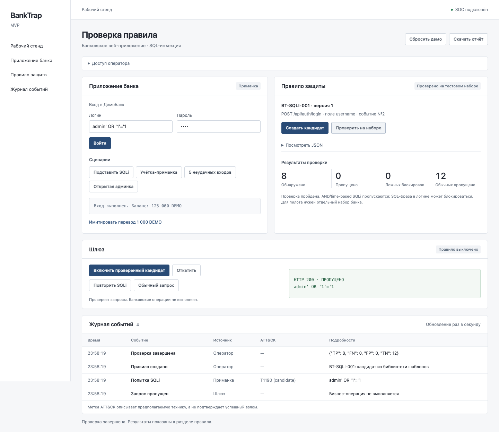
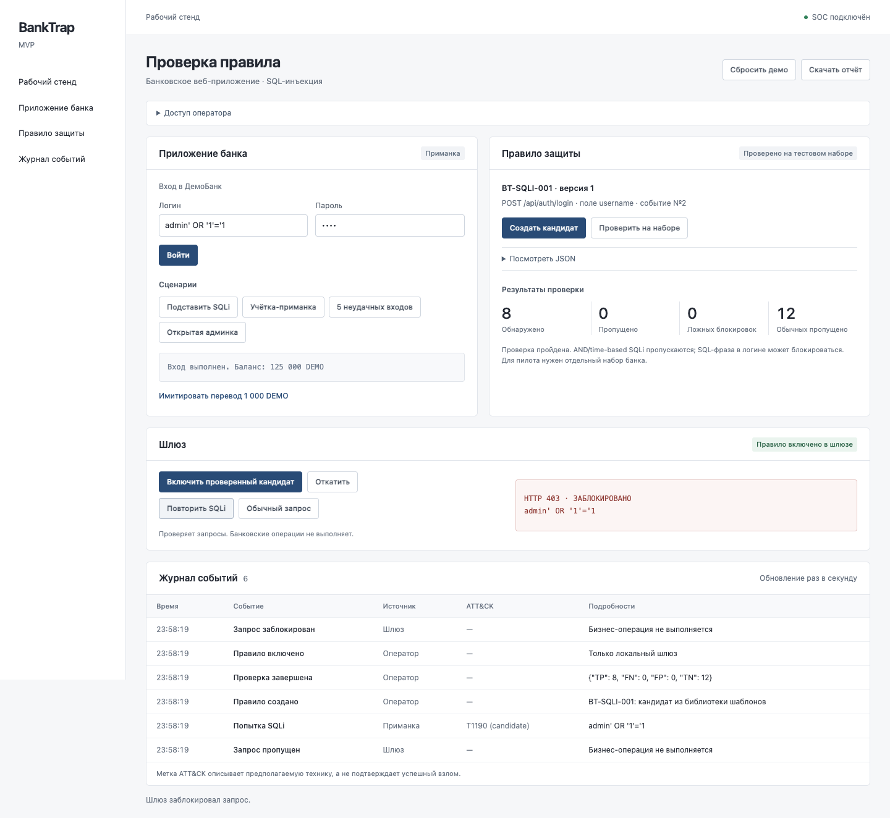
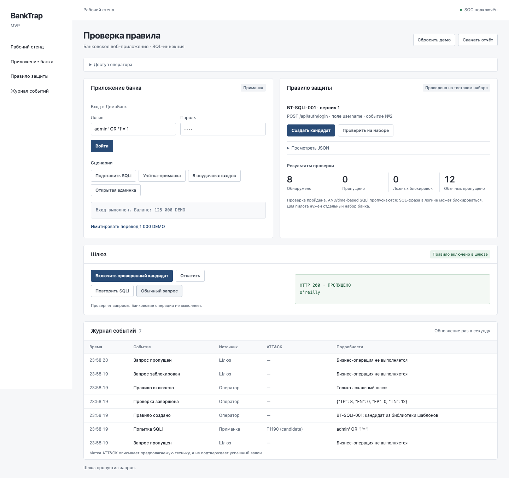
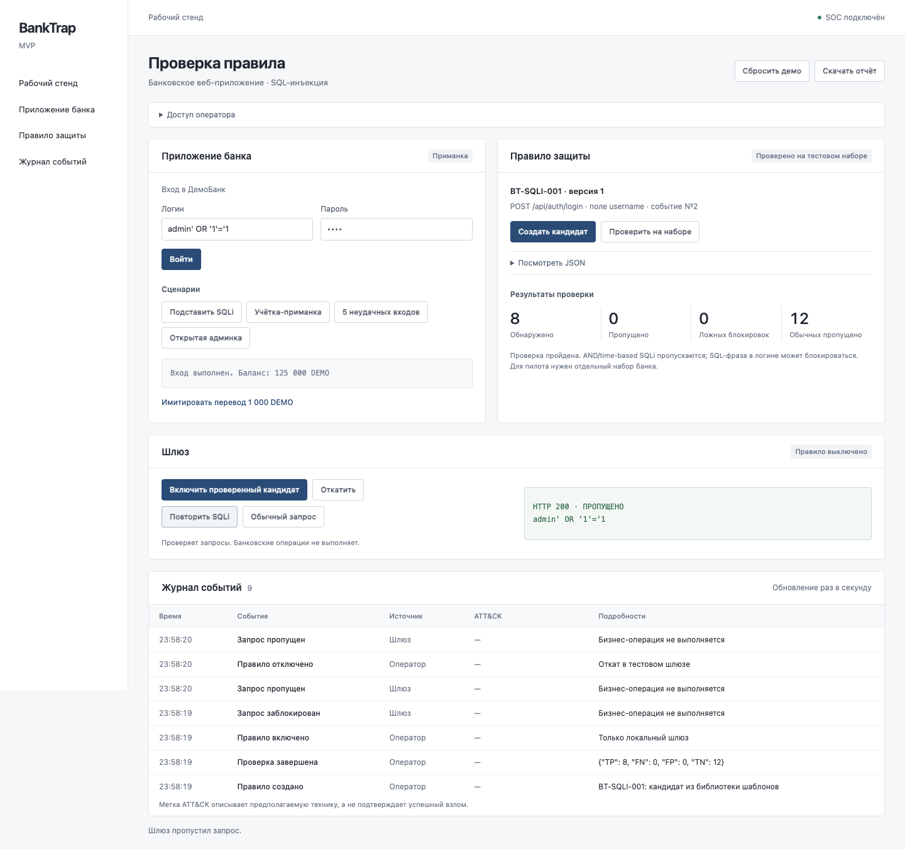

# Скриншоты демо BankTrap

Снимки работающего локального приложения. Запросы и данные синтетические. После подключения раздел с токеном оператора свёрнут.

## 1. Начальное состояние

SOC подключён. Событий ещё нет, правило выключено.

## 2. Запрос без правила

Шлюз пропускает SQLi-запрос: HTTP 200.

## 3. Событие атаки

Приманка имитирует вход. В журнале появляется «Попытка SQLi» с меткой T1190.

## 4. Проверка правила

На демонстрационном наборе: 8 атак обнаружено, 12 обычных запросов пропущено. Известные ограничения перечислены в интерфейсе.

## 5. Атака заблокирована

После включения правила тот же запрос получает HTTP 403.

## 6. Обычный запрос проходит

Логин с апострофом o'reilly получает HTTP 200 при включённом правиле.

## 7. Откат

Правило отключено. Повторный запрос снова получает HTTP 200.

